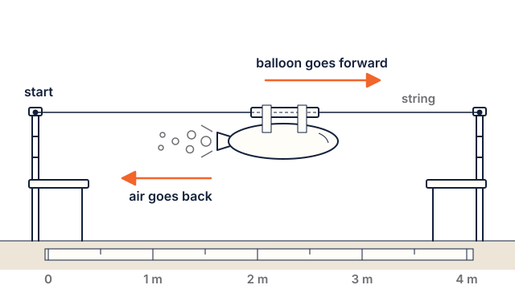

# Lesson pictures

Hand-written SVG drawings of the hands-on activities, one or more per lesson. They are the
source for the web lessons (`build_site.py` inlines them into `server/static/learn/…`) and the
worksheets (`gen_ws.py` inlines them too), and GitHub shows them in the lesson markdown.

A lesson uses a picture with a markdown image line on its own, usually right under the
`### 3. Do: …` heading:

    

The alt text becomes the caption on the web page. Keep it one sentence.

## House style (from `docs/brand/brand.md`, "Illustration style")

- **Canvas:** `viewBox="0 0 640 360"` with `width="640" height="360"` (taller `0 0 640 420` is
  fine when needed). Transparent background: the page puts the picture on a Paper-white card,
  in light and dark mode alike.
- **One pen:** part outlines 2 px Night `#12203A`, round joins, filled Paper-white `#FFFDF8`;
  detail lines 1 px Night; hidden edges 1 px dashed `4 3`; centre lines 1 px Grey `#6E6E73`
  dash-dot `14 4 2 4`.
- **Colour means something,** the same everywhere:
  - Launch orange `#F2652B`: motion arrows (2.5 px, solid triangle head, one arrow per motion),
    "do this here" marks, parachute canopies, the fletching. Text on orange is Night.
  - Sky blue `#3D8BFD`: the balance point (CG) dot, and dashed flight paths (`10 8`).
  - Signal red `#E5484D`: the push point (CP) dot. Blue and red always come as a pair.
  - Go green `#2FB67C`: "good / stable / farthest" ticks.
  - Grey `#6E6E73`: measurement lines, dimension arrows, captions.
  - Soft fills for ground, sky or table: `#EDE6D8` (Paper-200), `#DDEAFF` (Sky-100), `#DCF3E8` (Green-100).
- **Labels:** few and short (2–4 words), Space Grotesk 600, 15–17 px, Night or Grey.
  `font-family="Space Grotesk, Inter, sans-serif"`. Numbers with units (`4 m`, `45°`).
- **Step tags:** a numbered sequence uses chamfered orange tags with a Night number
  (an octagon about 26 × 24 with 5 px corners, Space Grotesk 700).
- **People:** friendly and simple. Hands, arms and heads drawn with the same 2 px Night pen on
  Paper-white, no faces beyond two dots, no skin tones (keeps everyone in). Kids wear the safety
  glasses the lesson asks for.
- **Flat:** no gradients, shadows, filters, blur, opacity tricks or perspective.

## Rules for the files

- Plain SVG 1.1: presentation attributes only, **no `<style>` blocks, no `class`**, no scripts,
  no external links, images or fonts.
- **Every `id` starts with the file name** (`e1-…`): the pictures are inlined into one page,
  so ids must not clash. Same for `url(#…)` references.
- `role="img"` and a `<title>` that says what the picture shows.
- Aim for under 15 KB.
- Check it: `node docs/curriculum/tools/render_art.js docs/curriculum/art/<file>.svg out.png`
  renders it to a PNG at 2×.

## Files

| File | Lesson | Shows |
|---|---|---|
| `e1-balloon-rocket.svg` | Elementary 1 | Balloon taped to a straw on a string between two chairs |
| `e2-straw-rocket.svg` | Elementary 2 | Roll, fold the nose, tape fins, puff to launch |
| `e3-angle-test.svg` | Elementary 3 | Squeeze-bottle launcher at 30°, 45° and 60° and where each lands |
| `e4-swing-test.svg` | Elementary 4 | Swinging a paper rocket on a string: no fins, fins, clay in the nose |
| `e5-stomp-rocket.svg` | Elementary 5 | The stomp launcher (bottle, hose/pipe) and a paper stomp rocket |
| `e6-fair-test.svg` | Elementary 6 | Change one thing, launch, measure, improve |
| `e7-parachute-drop.svg` | Elementary 7 | Small and big parachutes and washers with no parachute, timed |
| `e8-launch-day.svg` | Elementary 8 | Stomp launch with trackers holding 45° sighting cards |
| `m1-balloon-mass.svg` | Middle 1 | Balloon rocket with added clips: same push, more mass |
| `m2-forces.svg` | Middle 2 | The forces on a rocket in flight, and launch angle |
| `m3-balance-push-point.svg` | Middle 3 | Balance point on a finger, the cut-out push point, the swing test |
| `m4-nose-cone-test.svg` | Middle 4 | Nose shapes and the drag test |
| `m5-inside-a-motor.svg` | Middle 5 | A cut-away motor and the energy story of a flight |
| `m6-design-with-a-model.svg` | Middle 6 | Change one thing in a computer model (a simple screen, not the real app), compare, choose |
| `m7-parachute-energy.svg` | Middle 7 | Drop test and landing energy |
| `m8-inclinometer.svg` | Middle 8 | Measuring a tall object with an inclinometer and a baseline |
| `m9-launch-day.svg` | Middle 9 | The launch site: pad, adult at the controller, safe distance, trackers |
| `design-cycle.svg` | Both | Ask, imagine, plan, create, test, improve (the words in middle Lesson 6 and worksheet W6) |
