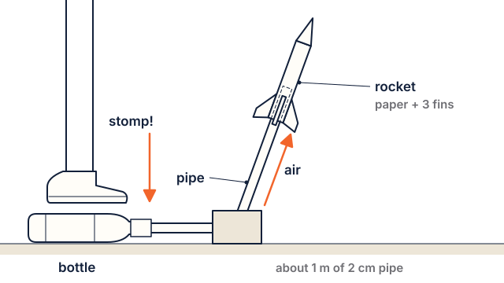

# Lesson 5: Be an engineer: design a stomp rocket

**Time:** about 45 minutes. **Worksheet:** E5 Design plan. **Rocket Builder:** on the projector or tablets.

## Standards

| Code | In plain words |
|---|---|
| **3-5-ETS1-1** | Say what a design must do (criteria) and what limits it has (constraints: materials, time, cost). |
| **3-5-ETS1-2** | Come up with more than one design and compare how well each might work. |

**Practice:** asking questions and defining problems; designing solutions. **Crosscutting concept:** influence of engineering on people (engineers improve designs to meet a need).

## I can…

- I can name the criteria (what my rocket must do) and the constraints (my limits).
- I can draw two different designs and pick one, giving a reason.
- I can build my rocket from my plan.

## Words to know

- **Engineer**: someone who designs things to solve problems.
- **Criteria**: what the design must do to succeed.
- **Constraints**: the limits, like how much paper, tape or time you have.
- **Prototype**: a first version you build to test.

## Materials

For each student:

- 1 sheet of paper, 1 index card, 50 cm of tape (that's the constraint!)
- A tube to roll around that fits the stomp launcher (a 2 cm PVC pipe or a marker)
- Scissors, pencil, worksheet E5

For the class: a stomp-rocket launcher (a kit, or a DIY one: a 2-litre bottle, a 1 m length of 2 cm PVC pipe and duct tape), and Rocket Builder on the projector or tablets.

## Steps

### 1. Hook (5 minutes)

> NASA engineers get a problem: "Build a rocket that can carry this, and land it here." Today you get a problem too.

### 2. Define the problem (10 minutes)

Write it on the board and on E5:

- **Problem:** design a paper rocket that flies straight off the stomp launcher and lands in the target zone.
- **Criteria:** it flies nose-first · it lands in the zone · it still works after 3 launches.
- **Constraints:** 1 sheet of paper, 1 index card, 50 cm of tape, 15 minutes to build.

**Rocket Builder check (3 minutes):** on the projector, show two rocket designs side by side (change only the fins, then build). Ask: *Which one meets the criterion "flies straight"? How can we tell?* (The score is green; the blue dot is in front of the red dot.)

### 3. Imagine and plan (10 minutes)

1. On E5, draw **two different** rocket ideas. Change the fins, the nose or the length.
2. Tick which criteria each one might meet. Pick one. Write why.

### 4. Build (15 minutes)

1. Roll the paper around the tube and tape it. Close the top into a nose and tape it airtight.
2. Cut fins from the index card. Tape them on evenly.
3. Write your name on it. Testing is next lesson!

### 5. Wrap up (5 minutes)

Pairs share: *What did you pick, and why?*

## Check for understanding

1. What is the difference between a criterion and a constraint?
2. Name one constraint in today's challenge.
3. Why do engineers draw more than one idea?

**Answer key**

1. A criterion is what the design must do; a constraint is a limit you must work within.
2. 1 sheet of paper, 1 index card, 50 cm of tape, or 15 minutes.
3. So they can compare and pick the one most likely to meet the criteria.

## Teacher notes

- **Target zone:** mark a zone with cones about 5–10 m from the launcher. Adjust to your space.
- **Grade 3:** give a fin template and let students choose between 2 shapes. **Grade 5:** let students add their own criterion (for example "goes higher than the basketball hoop").
- **Rocket Builder as a class tool:** in Beginner mode it takes a few seconds per build. Have one student "drive" on the projector while the class decides what to change. On tablets, groups can build their own; no account or download is needed.
- **No downloads or printing for this age group.** Rocket Builder's printed rockets fly on real motors, which are rated 12+.
- **DIY stomp launcher:** tape the PVC pipe into the bottle's mouth airtight. Students stomp on the bottle; the air shoots up the pipe and launches the paper rocket.
