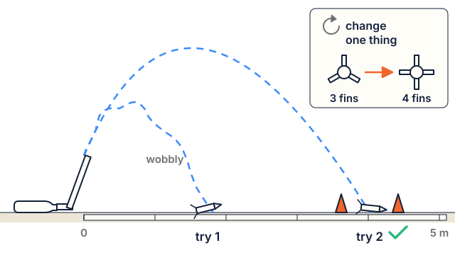

# Lesson 6: Test it, fix it: fair tests and improvements

**Time:** about 45 minutes. **Worksheet:** E6 Test and improve.

## Standards

| Code | In plain words |
|---|---|
| **3-5-ETS1-3** | Run fair tests to find where a model fails and what to improve. |
| **3-5-ETS1-2** | Compare designs by how well they meet the criteria. |

**Practice:** planning and carrying out investigations. **Crosscutting concept:** cause and effect.

## I can…

- I can test my rocket fairly, with the same stomp each time.
- I can find what went wrong (the failure point) and fix it.
- I can test again and tell if my change helped.

## Words to know

- **Fair test**: a test where only one thing changes.
- **Failure point**: the part of the design that didn't work.
- **Improve**: change the design to make it work better.

## Materials

- Rockets from Lesson 5, spare paper, index cards and tape
- The stomp launcher, cones for the target zone
- **Safety glasses** for everyone
- Worksheet E6

## Steps

### 1. Hook (5 minutes)

> Real engineers almost never get it right the first time. They test, find what failed, fix it and test again. That loop is how all rockets get better.

### 2. Plan a fair test (5 minutes)

Agree as a class: the same launcher, the same stomper, the same kind of stomp (a "one-foot jump"), and the rocket always starts at the bottom of the pipe.

### 3. Test (15 minutes)

1. **Glasses on.** Everyone stands behind the line.
2. Countdown: "3, 2, 1, launch!" The stomper stomps only on "launch!"
3. On E6, tick what happened: **straight or wobbly**, **in the zone or not**, **still works or broken**.
4. Each rocket flies 2 times.

### 4. Improve and retest (15 minutes)

1. Look at your ticks. Circle the **failure point** on your drawing (fins loose? nose leaked? too heavy?).
2. Change **one thing** to fix it.
3. Fly 2 more times. Did it help?

### 5. Wrap up (5 minutes)

Share one fix that worked. Make a class list: "Things that make paper rockets fly better."

## Check for understanding

1. Why should the stomp be the same each time?
2. A rocket's nose came open and air leaked out. What is the failure point? How would you fix it?
3. You changed the fins and the nose at the same time, and it flew better. Do you know which change helped?

**Answer key**

1. So the only difference is the rocket, and the test is fair.
2. The nose. Fold and tape it shut so it is airtight.
3. No. Change one thing at a time to know.

## Teacher notes

- **What to expect:** common failures are leaky noses, crooked or floppy fins, and fins taped too high up the body. A rocket that tumbles usually needs bigger fins or fins farther back.
- **Grade 3:** focus on "what broke and how did you fix it". **Grade 5:** record the landing distance and compare before and after.
- **Safety:** glasses on; only the stomper goes near the launcher; nobody stands in front of or over the pipe; fetch rockets only on "clear".
- **Rocket Builder link (optional):** the app does the same thing on screen: change one thing, build, check the score. Show students that engineers test on a computer model before they build.
- **Keep the improved rockets** for Lesson 8 (launch day).
