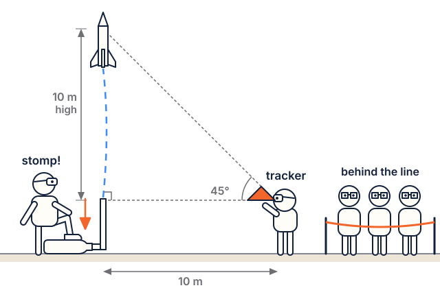

# Paper-rocket safety (grades 3–5)

Read this page before Lesson 1, and again before launch day (Lesson 8).

## The big rules

1. **Paper rockets only.** In the elementary track, students fly balloon, straw and stomp (air-pressure) rockets. Model rocket motors and Rocket Builder kits are rated **12+**, and students under 12 don't handle or fly them.
2. **Glasses on** for straw and stomp rockets, for everyone nearby.
3. **Never aim** a rocket at a person, an animal or a window.
4. **Wait for "launch!"** Count down out loud. Nobody blows, squeezes or stomps until "launch!", and only when everyone is behind the line.
5. **Never chase a rocket** into a road, a tree, a power line or a neighbour's yard. Tell an adult.

## Rules for each activity

- **Balloon rockets (Lesson 1):** nobody stands at the end of the string. Use latex-free balloons if anyone has a latex allergy.
- **Straw rockets (Lessons 2, 3):** glasses on. One straw per person. Launch in one direction only, and fetch rockets only when the adult says "clear".
- **Swing test (Lesson 4):** outdoors or in a big room, a string about 1 m long, nobody within 3 m, one swinger at a time.
- **Stomp rockets (Lessons 5, 6, 8):** glasses on. Only the stomper goes near the launcher. Nobody stands in front of or leans over the pipe. Load the rocket only when the stomper is off the bottle.
- **Parachute drops (Lesson 7):** an adult does any dropping from a height. Students stay off chairs and tables.
- **Tracking (Lesson 8):** never look at the sun.

## Launch team jobs

| Job | Who |
|---|---|
| Countdown caller | A student |
| Stomper | A student (one at a time) |
| Trackers (45° cards) | Two students |
| Recorder (launch log) | A student |
| Recovery crew | Students, only when the adult says "clear" |
| Launch boss: checks the area and says "clear" | An adult |

## About the 3D-printed rocket demo

Rocket Builder's printed rockets fly on real model rocket motors, which are rated 12+. In this track the printed rocket is **optional and run by the instructor**:

- **Show-and-tell (Lesson 4):** a printed rocket with **no motor** in it. Students can hold it and find its balance point.
- **Flight demo (Lesson 8, optional):** only an adult experienced with model rockets, following the [NAR Model Rocket Safety Code](../middle/safety.md), on a field big enough for the motor. Students watch from behind a spectator line at least 30 feet (10 m) from the pad, never handle motors, igniters or the launch key, and never go to the pad. Visiting a local NAR club launch as spectators is an easy alternative.

Rocket Builder itself is safe for any age: in the elementary track it is used on a projector or tablet only, with no downloads, prints or orders.
