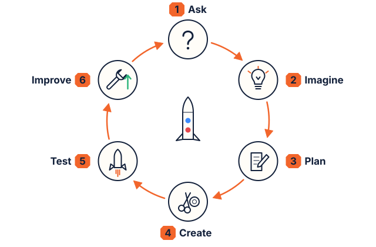
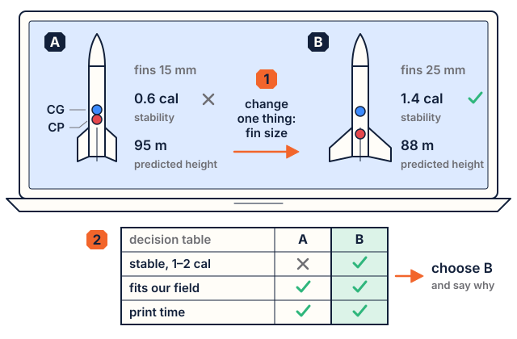

# Lesson 6: Design with a computer model

**Time:** about 60 minutes (90 with Part C). **Worksheet:** W6 Design log. **Rocket Builder:** Beginner, then Advanced.

## Standards

| Code | In plain words |
|---|---|
| **MS-ETS1-1** | Define the criteria and constraints precisely, including effects on people and the environment. |
| **MS-ETS1-2** | Evaluate competing designs with a systematic process (a decision table). |
| **MS-ETS1-4** | Use a model to generate data, test and improve a design. |
| **8.SP.A.1** (math) | Scatter plot of two variables; describe the pattern. |

**Practice:** developing and using models. **Crosscutting concept:** systems and system models.

## I can…

- I can write the criteria and constraints for a rocket.
- I can use Rocket Builder to change one variable at a time and record the stability score.
- I can pick a final design with a decision table and explain my choice with data.

## Words to know

- **Criteria**: what the design must do. **Constraints**: the limits.
- **Iteration**: one trip around the design cycle (ask, imagine, plan, create, test, improve).
- **Model**: something that stands in for the real thing so you can test it. Rocket Builder is a computer model.

## Materials

Computers or tablets with Rocket Builder (https://rocket.quiverdesignworks.net), W6. 12+ track: a 3D printer and filament (adult runs it), or an order.

## Steps

### 1. Define the problem (10 minutes)

**Criteria:** score 1–2 cal (2–3 OK) · at least one motor gets **✓ Good** (5× thrust-to-weight, 15 m/s off the rod, 30 m high) · the predicted flight fits our field.
**Constraints:** our printer's height · our field size · motor cost (the smallest motor that works) · safety: no people, roads, dry grass or trees near the pad.

### 2. Part A: one variable in Beginner mode (20 minutes)

1. Pick a motor size (M18 is common) and your printer height. Keep fins and nose fixed.
2. Start at the shortest height; build; record height, score, best motor, altitude, power and "fins grew?" (Grown-up details → Build notes).
3. Add about 50 mm each time, 5 heights. Plot height vs score on W6.

### 3. Part B: Advanced mode (15 minutes)

Switch to **Advanced**. Under **Fins**, tick **Custom fin size** and change only the span (15, 20, 25, 30 mm). Find where the score crosses 1.0.

### 4. Choose (10 minutes)

Score your top 3 designs in the decision table (stability, altitude fits field, print time, looks). Pick one; write a sentence using your data. **Save** it, then **▶ Watch it launch**.

### 5. Wrap up (5 minutes)

What can't the model tell you? (Real print mass, glue, paint, wind, motor-to-motor variation.)

## Check for understanding

1. What's the difference between a criterion and a constraint?
2. Why change one thing at a time?
3. Your design scores 0.8 cal. Name two fixes.
4. Your design scores 3.6 cal. Problem?

**Answer key**

1. A criterion is what it must do; a constraint is a limit.
2. To know which change caused the result.
3. A taller body; bigger or swept fins; nose weight; a lighter motor.
4. A small one: over-stable, it weathercocks into the wind. Smaller fins or a shorter body.

## Teacher notes

- **What to expect:** with the same fins, taller rockets score higher. Very short ones show "fins grew" (the app enlarged them) and a score just above 1. In one test (M18, trapezoid, body 250 mm): span 15 mm gave −0.5 cal, 25 mm 1.3, 30 mm 1.7. A negative score means the CP is in front of the CG.
- **12+ track:** when the design is chosen, download the ZIP and an adult starts printing (parts print for several hours). Or order it printed (an adult needs an account). Assemble with an adult by Lesson 8, following the build notes and the assembly guide.
- **Students under 12** keep their design on screen (no download, print or order).
- **Environment connection (optional):** the constraint "impacts on people and the natural environment" covers the launch site (fire risk, litter, wildlife) and material use: a printed rocket uses about 50–100 g of PLA; failed prints are waste. Students can add a constraint about it.
- **Further resources:** Apogee Components' free lessons for grades 5–8 (apogeerockets.com/Teach-with-Model-Rockets) use kit rockets; *Rocket Optimization* (58-2) fits here.
