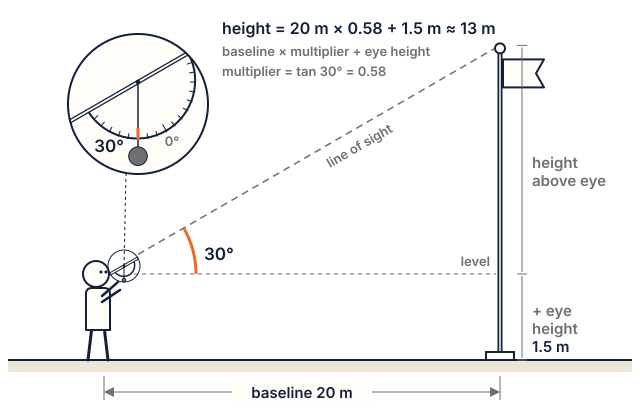

# Lesson 8: Launch prep: safety, tracking and preflight

**Time:** about 90 minutes, or two class periods. **Worksheets:** W8 Altitude tracking, the inclinometer template, W8b Safety rules, W8c Launch checklists. **Rocket Builder:** *How big a launch field?* card.

## Standards

| Code | In plain words |
|---|---|
| **MS-ETS1-1** | Define constraints precisely, including safety and effects on people and the environment. |
| **MS-PS2-2** | Plan an investigation (here, how to measure the flight). |
| **7.G.A.1, 7.RP.A.2** (math) | Scale drawings; proportional reasoning (height = baseline × multiplier). |

**Practice:** planning and carrying out investigations. **Crosscutting concept:** scale, proportion and quantity.

## I can…

- I can explain the main rules of the NAR Model Rocket Safety Code and why each matters.
- I can build an inclinometer and use it to find the height of something tall.
- I can run a preflight check, including the balance-point go/no-go test.

## Words to know

- **Safety code**: the rules everyone at a launch follows.
- **Safety key**: no key in the controller, no launch. **Misfire**: the button is pressed but the motor doesn't light.
- **LCO / RSO**: the adults in charge of the launch button and of checking rockets.
- **Angle of elevation, baseline**: how steeply you look up; your measured distance from the pad.

## Materials

Inclinometer template (printed at 100%), cardstock, a straw, string, a washer, tape, a long tape measure, calculators, W8, W8b, W8c. 12+ track: the assembled rocket, a kitchen scale, string, a zip bag and some US nickels, one motor (adult handles it, no igniter), the launch controller with no igniter attached.

## Steps

### 1. The safety code (20 minutes)

Read the [safety page](safety.md) together. For each rule, ask *why?* Do the "Is it safe?" stories on W8b. Assign jobs: adults are LCO and RSO and handle motors, igniters and the key; students call the countdown, track, record and recover.

**Misfire drill:** with no motor and no igniter, set up the pad and controller. "Range is clear! 5, 4, 3, 2, 1, launch!" The adult pretends it didn't go, takes out the key, and everyone counts 60 seconds before anyone walks up.

### 2. Inclinometer and a tall object (30 minutes)

1. Build the inclinometer from the template (straw on the top edge, weighted string at the pivot). Level = 0°.
2. Measure a 20 m baseline from a tree or pole. Read the angle to the top 3 times; average.
3. Height = baseline × multiplier (table on W8) + eye height. Check with a second baseline.

### 3. Preflight checks (12+ track, 30 minutes)

1. **Weigh** the rocket without a motor; compare with the app.
2. **Look it over:** fins firm, shock cord tied, parachute folded and not torn.
3. **Nose fit (coin breakout test; do it during assembly, before the body sections are glued):** tie a cord to the nose's tie bar, push the nose into its body section, hold the section nose-down and hang a zip bag on the cord. Add nickels (5 g each) until the nose pulls out. About 4–5 nickels is right for an M18 Starter rocket; Rocket Builder's build notes give the target. Too few: tape the shoulder; too many: sand it.
4. **Balance point, go/no-go:** an adult puts a motor in (no igniter). Balance the rocket on a finger and measure from the nose tip. **Go** only if this CG is at least one body width in front of the app's CP. The adult takes the motor out again.
5. **Field check:** compare the app's **How big a launch field?** with your field. Too small? Pick a smaller motor that still gets a ✓, or go to a club launch.

### 4. Wrap up (10 minutes)

Check the wind forecast: under 20 mph (under 10 is better). Pack the launch box (W8c).

## Check for understanding

1. How far back must everyone stand for a D motor or smaller?
2. After a misfire, what two things happen before anyone goes to the pad?
3. Baseline 50 m, angle 60° (multiplier 1.73), eye height 1.5 m. How high?
4. The measured CG is 10 mm behind the app's CP. Go or no-go?

**Answer key**

1. At least 15 feet (about 5 m).
2. The key comes out (or the battery is disconnected), then everyone waits 60 seconds.
3. 50 × 1.73 + 1.5 ≈ **88 m**.
4. No-go: the CG must be in front of the CP by at least one body width. Add nose weight or bigger fins, and check again.

## Teacher notes

- **Tracking on launch day:** use a baseline of about half to all of the predicted altitude (angles between 30° and 60° are most accurate), stand to the side of the wind, and use two trackers on different sides.
- **Extension (tangent):** height = baseline × tan(angle) + eye height. A 2° error at 45° changes a 50 m-baseline height by about 7%; at 75° by about 16%, so long baselines are better.
- **Swing test:** students can swing-test the real rocket (motor in, no igniter) as a demonstration, but the balance-point check is the go/no-go.
- **Assembly** happens out of class with an adult, following Rocket Builder's build notes and the assembly guide. Adults use the glue.
- **Further resources:** Apogee Components' free newsletter *Tracking Model Rockets* (apogeerockets.com/education/downloads/Newsletter222.pdf) and their Teaching Tips page (apogeerockets.com/Edu/Teaching_Tips) for running a launch with a class (two pads, separate launch and recovery crews, the adult installs igniters).
